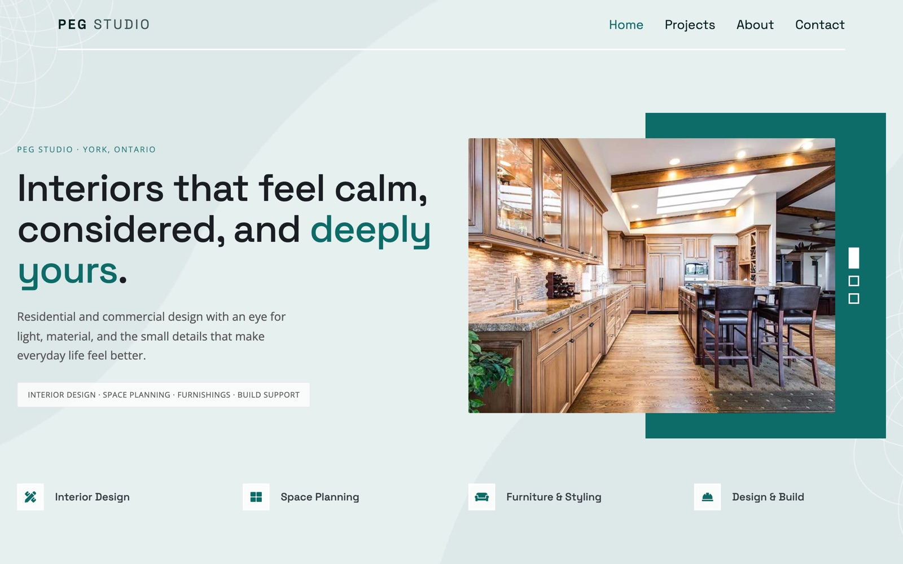

<div align="center">

# 🛋️ PEG Studio — Interior Design

A calm, elegant website for an interior design studio in York, Ontario, with projects, services and a contact page.

<a href="https://peg-studio-ten.vercel.app/"></a>
<a href="https://github.com/miladmo68/PegStudio"></a>
<a href="https://miladweb.com"></a>

**🔗 Live:** [peg-studio-ten.vercel.app](https://peg-studio-ten.vercel.app/)

</div>

<p align="center">
  
</p>

## ✨ Features

- Home, about, projects, services and contact pages
- Image-led layout for interior design work
- Responsive design for mobile and desktop

## 🛠️ Tech Stack

     

## 🚀 Getting Started

**Run locally**

```bash
git clone https://github.com/miladmo68/PegStudio.git
cd PegStudio
# open index.html in your browser, or serve the folder:
npx serve .
```

## 📁 Project Structure

```
PegStudio/
├── css/
├── img/
├── js/
├── lib/
├── scss/
├── 404.html
├── about.html
├── contact.html
├── feature.html
├── index.html
├── interior-design-website-template-free.jpg
├── LICENSE.txt
├── project-catan.html
└── project-ecoscape.html
```

## 👤 Author

**Milad Mohammadi** — Frontend-Focused Full-Stack Developer, Toronto 🇨🇦

[](https://miladweb.com)
[](https://www.linkedin.com/in/miladmo68/)
[](https://github.com/miladmo68)

<p align="center"><sub>If you like this project, consider giving it a ⭐</sub></p>
